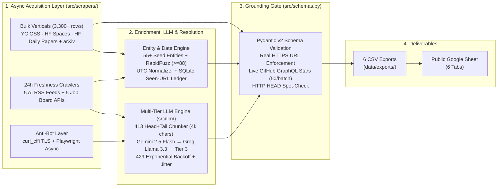

# FrontierAtlas — Asynchronous AI & Venture Intelligence Ingestion Pipeline


A fault-tolerant, asynchronous Python ingestion pipeline built to acquire, normalize, deduplicate, and ground AI ecosystem intelligence across **Startups**, **Products**, **Research Papers (with live GitHub stars)**, **24-Hour Fresh Jobs**, **24-Hour Fresh News**, and **Canonical Entity Resolution Logs**.

Every record is validated through a strict Pydantic v2 Grounding Gate so zero ungrounded or hallucinated URLs can reach the exported dataset.

---

## Live Deliverables

| Deliverable | Link | Status |
| :--- | :--- | :--- |
| **Data Output (6-Tab Google Sheet)** | [FrontierAtlas_Ingestion_Output_Ajit_Sharma](https://docs.google.com/spreadsheets/d/1Cz02rmFumGjH66jT93Z2pW7f5dy-O3VpAVWfaAr0wGY/edit?usp=sharing) | Public Viewer · 3,412+ Data Rows + 2,300 Audit Events |
| **System Design Document (`architecture.pdf`)** | [Google Drive Folder](https://drive.google.com/drive/folders/1ZwPxxI1-k5dVG1IY8DmgKzJ35DTeVvrE) & `./architecture.pdf` | 3-Page Production Scale Architecture |
| **Source Code Repository** | [ajx1tech/frontieratlas-ingestion-pipeline](https://github.com/ajx1tech/frontieratlas-ingestion-pipeline) | Full Async Pipeline + Automated Test Suite |

---

## Verified Pipeline Output Summary

Executed locally on Windows 11 (`Python 3.13.7`, `pytest 9.2.0`) via `python -m src.pipeline`:

| Sheet Tab | Verified Output | Target Requirement | Key Verification |
| :--- | :--- | :--- | :--- |
| **1. Startups** | **1,100 rows** | `>= 1,000` | Real Y Combinator directory URLs + `employeeCount` |
| **2. Products** | **1,100 rows** | `>= 1,000` | Real Hugging Face Spaces URLs + normalized `pricingModel` |
| **3. Research Papers** | **1,100 rows** | `>= 1,000` | Verified arXiv/HF URLs + live batched GitHub GraphQL stars |
| **4. Jobs (<24h)** | **100 rows** | Strict `<24h` across 5 boards | Max verified age: **22.77 hours** |
| **5. News (<24h)** | **12 rows** | Strict `<24h` across 5 sources | Max verified age: **23.96 hours** + full-text extraction |
| **6. Entity Mapping Log** | **2,300 events** | Raw vs. Canonical audit | Exact seed, legal-suffix strip, and `RapidFuzz` logs |
| **Null / Invalid URLs** | **0** | Must be `0` | Enforced by Pydantic v2 Grounding Gate + `HEAD` probes |

---

## System Architecture



---

## How the Pipeline Works (Phase-by-Phase)

### Phase I — Massive Bulk Acquisition (`src/scrapers/bulk_*.py`)
* **Startups (`bulk_startups.py`)**: Fetches structured records from the Y Combinator OSS directory API, mapping `team_size` to `content.data.employeeCount` and preserving canonical `ycombinator.com/companies/{slug}` source URLs.
* **Products (`bulk_products.py`)**: Pulls live deployed AI apps from the Hugging Face Spaces API with canonical `huggingface.co/spaces/{id}` URLs, resolving parent organizations and classifying `pricingModel` (`FREE`, `FREEMIUM`, `PAID`, `ENTERPRISE`).
* **Research Papers + Live GitHub Stars (`bulk_papers.py`)**: Correlates AI papers from Hugging Face Daily Papers and the arXiv Atom API with their linked GitHub repositories. To avoid REST rate limits, repositories are grouped into **batches of 50** and queried via aliased **GitHub GraphQL** POST calls to retrieve exact real-time `stargazerCount` metrics.

### Phase II — High-Fidelity 24-Hour Signal Ingestion (`src/scrapers/fresh_*.py`, `src/freshness/date_engine.py`)
* **5 AI News Sources**: TechCrunch AI, The Verge AI, Ars Technica AI, MIT Technology Review AI, and MarkTechPost. Feeds are parsed with `feedparser` and full article text is extracted asynchronously using `httpx` + `trafilatura`.
* **5 Job Boards**: Greenhouse, Lever, Himalayas, RemoteOK, and Arbeitnow.
* **Freshness Engine**: Normalizes RFC-2822, ISO-8601, epoch timestamps, and relative strings (e.g., `"2 hours ago"`) into UTC and drops any record older than `24.0` hours. For dateless sources, a persistent **SQLite `seen_urls` ledger** (`url_hash`, `content_sha256`, `first_seen_utc`) provides deterministic novelty detection.

### Phase III — Multi-Tier LLM Extraction Engine (`src/llm/`)
* **413 Payload Protection (`chunker.py`)**: Strips HTML boilerplate (`<script>`, `<style>`, `<nav>`, `<footer>`) and applies semantic **head + tail truncation** capped at `4,000` characters so payloads never trigger `413 Payload Too Large` while preserving headers, dates, pricing, and remote-work clauses.
* **Resilient Fallback & 429 Handling (`orchestrator.py`)**: Routes structured JSON extraction across a 3-tier chain:
  1. **Tier 1**: Google Gemini (`gemini-2.5-flash`)
  2. **Tier 2**: Groq (`llama-3.3-70b-versatile`)
  3. **Tier 3**: OpenRouter (`deepseek/deepseek-r1:free`) / deterministic rule-based fallback
* Uses `asyncio.Semaphore` concurrency caps per provider and exponential backoff with random jitter on `429 Too Many Requests` / `503` responses before failing over to the next tier.

### Phase IV — Deterministic Entity Resolution (`src/resolution/`)
* Resolves noisy organization strings (e.g., `"OpenAI, Inc."`, `"Open AI"`, `"Anthropic PBC"`) through a 3-stage deterministic waterfall:
  1. **Legal Suffix & Punctuation Normalization** (`Inc.`, `LLC`, `Ltd.`, `Corp.`, `PBC`, `Technologies`).
  2. **Exact Alias Lookup** against `55+` canonical AI organizations (`seed_entities.py`).
  3. **Fuzzy Matching** via `RapidFuzz` (`token_sort_ratio >= 88`).
* Every normalization decision is recorded in `entity_mapping_log.csv` with raw string, canonical output, match method, and confidence score.

### Phase V — Anti-Bot Navigation (`src/scrapers/antibot_demo.py`)
* **Tier A (`curl_cffi`)**: Asynchronous Chrome TLS/JA3 fingerprint impersonation (`impersonate="chrome124"`) to bypass WAF/Cloudflare TLS checks at minimal RAM overhead.
* **Tier B (`playwright.async_api`)**: Headless Chromium with route-level asset blocking (`image`, `font`, `media`, `stylesheet`) and bounded semaphores for JavaScript-rendered pages.

### Phase VI — Zero-Hallucination Grounding Gate (`src/schemas.py`)
* Strict Pydantic v2 models enforce schema contracts (`schemaVersion="1.0"`, fixed `recordType`, ISO-8601 timestamps) across `StartupRecord`, `ProductRecord`, `ResearchPaperRecord`, `JobRecord`, and `NewsRecord`.
* Custom `@field_validator` rules reject empty URLs, non-HTTP(S) schemes, and placeholder domains (`example.com`, `localhost`), backed by asynchronous `HTTP HEAD` reachability checks during pipeline execution.

---

## Repository Structure

```text
frontieratlas-ingestion-pipeline/
├── README.md
├── architecture.pdf              # Phase VI 3-page production scale architecture
├── requirements.txt
├── .env.example                  # Required environment variable template
├── data/
│   └── exports/                  # Generated CSV outputs for all 6 Google Sheet tabs
├── src/
│   ├── config.py                 # API keys, concurrency semaphores, rate limits
│   ├── schemas.py                # Strict Pydantic v2 models & URL grounding gate
│   ├── pipeline.py               # Async CLI orchestrator & CSV exporter
│   ├── llm/
│   │   ├── chunker.py            # HTML stripping + 413 semantic head+tail truncation
│   │   └── orchestrator.py       # Gemini -> Groq -> Tier 3 fallback + 429 jitter
│   ├── resolution/
│   │   ├── seed_entities.py      # 55+ canonical AI startups & alias table
│   │   └── resolver.py           # 3-stage deterministic entity resolver + audit log
│   ├── freshness/
│   │   └── date_engine.py        # UTC/relative date parser + SQLite seen-URL state
│   └── scrapers/
│       ├── bulk_startups.py      # Y Combinator OSS -> 1,100 startups
│       ├── bulk_products.py      # Hugging Face Spaces -> 1,100 products
│       ├── bulk_papers.py        # HF Daily Papers + arXiv + GitHub GraphQL -> 1,100 papers
│       ├── fresh_news.py         # 5 AI RSS feeds + trafilatura (<24h)
│       ├── fresh_jobs.py         # 5 Job APIs + LLM role/remote extraction (<24h)
│       └── antibot_demo.py       # curl_cffi TLS impersonation + Playwright Async
└── tests/
    └── test_core.py              # Automated unit & integration tests (5/5 passing)
```

---

## Quickstart & Local Execution

### 1. Clone & Create Virtual Environment
```powershell
git clone [https://github.com/ajx1tech/frontieratlas-ingestion-pipeline.git](https://github.com/ajx1tech/frontieratlas-ingestion-pipeline.git)
cd frontieratlas-ingestion-pipeline
python -m venv .venv
.\.venv\Scripts\Activate.ps1
pip install -r requirements.txt
playwright install chromium
```

### 2. Configure Environment Variables
Copy `.env.example` to `.env` and populate your free-tier keys:
```env
GEMINI_API_KEY=your_gemini_key
GROQ_API_KEY=your_groq_key
OPENROUTER_API_KEY=optional_openrouter_key
GITHUB_TOKEN=your_github_readonly_pat
```

### 3. Run the Automated Test Suite
```powershell
pytest -v -s
```

| Test Case | Verified Behavior | Result |
| :--- | :--- | :--- |
| `test_grounding_gate_blocks_fake_url` | Rejects placeholder/non-HTTP URLs at Pydantic layer | `PASSED` |
| `test_413_chunker_truncates_large_html` | Strips boilerplate & truncates oversized HTML payloads | `PASSED` |
| `test_429_backoff_and_tier_failover` | Triggers jittered backoff on `429` and fails over to Tier 2 | `PASSED` |
| `test_entity_resolution_canonicalization` | Maps messy legal/spacing variants to canonical names | `PASSED` |
| `test_freshness_date_parsing_and_sqlite_heuristic` | Normalizes relative dates & detects repeat URLs via SQLite | `PASSED` |

### 4. Run the Full Ingestion Pipeline & Anti-Bot Probe
```powershell
# Run all 6 verticals and export CSVs to data/exports/
python -m src.pipeline

# Run standalone anti-bot TLS + Playwright verification
python -m src.scrapers.antibot_demo
```

---

## Tech Stack

* **Runtime & Async I/O**: Python 3.13, `asyncio`, `httpx`, `aiohttp`
* **Extraction & Parsing**: `trafilatura`, `feedparser`, `dateparser`, `htmldate`, `lxml`
* **LLM & GraphQL Clients**: `google-genai`, `groq`, GitHub GraphQL API
* **Validation & Resolution**: `pydantic` v2, `rapidfuzz`, `sqlite3`, `pandas`
* **Anti-Bot & Testing**: `curl-cffi`, `playwright`, `pytest`, `pytest-asyncio`